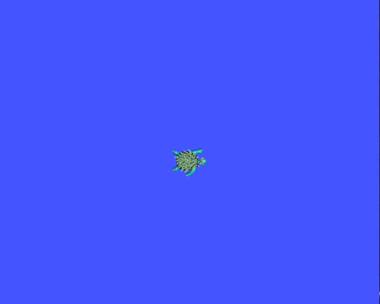
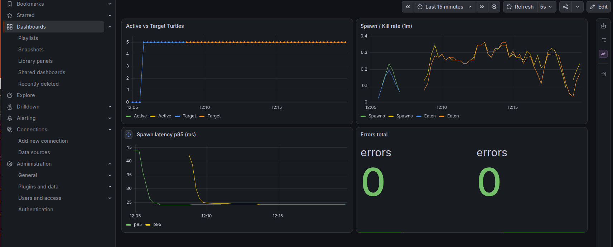

# Turtlesim Monitoring
Проект на ROS 2 Humble для управления черепашками в turtlesim. Включает в себя автоматический спавн, логику поедания цели и отправку метрик.

В проект добавлен Docker стек для мониторинга: Prometheus собирает метрики с нод, Grafana строит графики, Loki собирает логи.

## Демонстрация

## Установка и запуск
Для запуска нужен Docker и Docker Compose. Если у тебя Linux, также нужен работающий X11 сервер для отображения окна turtlesim.

Сборка и запуск:

`make build make up`

Проверить статус сервисов:

`make status`

Остановить все контейнеры:

`make down`

## Что внутри
Стек состоит из нескольких сервисов:

- turtles_app - основное приложение ROS 2, внутри которого запускаются turtlesim, менеджер и контроллер.

- prometheus - собирает метрики с приложения на портах 9091 и 9092.

- grafana - отображает дашборды, доступна на порту 3000.

- loki и promtail - собирают и хранят логи приложения.

Доступные эндпоинты после запуска:

| Сервис | Адрес |
| --- | --- |
|Grafana | http://localhost:3000 (admin / admin) |
| Prometheus | http://localhost:9090 |
| Loki | http://localhost:3100 |
| Метрики менеджера | http://localhost:9091/metrics |
| Метрики контроллера | http://localhost:9092/metrics |

## Grafana demo

## Пакеты ROS 2
Если нужно собрать проект локально без Docker:

`text colcon build --packages-select my_robot_interfaces my_cpp_pkg first_launchfile_bringup source install/setup.bash ros2 launch first_launchfile_bringup turtle_sim_launch.py`

Структура пакетов:

- my_robot_interfaces - кастомные сообщения и сервисы (TurtleInfo, RemoveTurtle).

- my_cpp_pkg - сами ноды (turtle_manager и turtle_driver).

- first_launchfile_bringup - launch файлы и параметры.

## Полезные команды
Получить сырые метрики через терминал:

`make metrics`

Посмотреть логи приложения:

`docker compose logs -f turtles_app`

Войти внутрь контейнера с приложением:

`make shell`